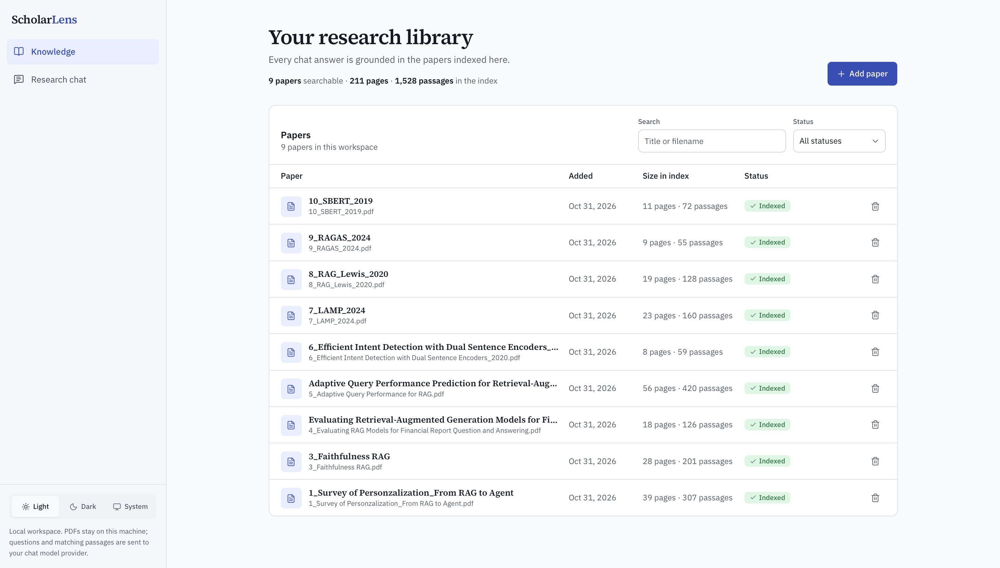
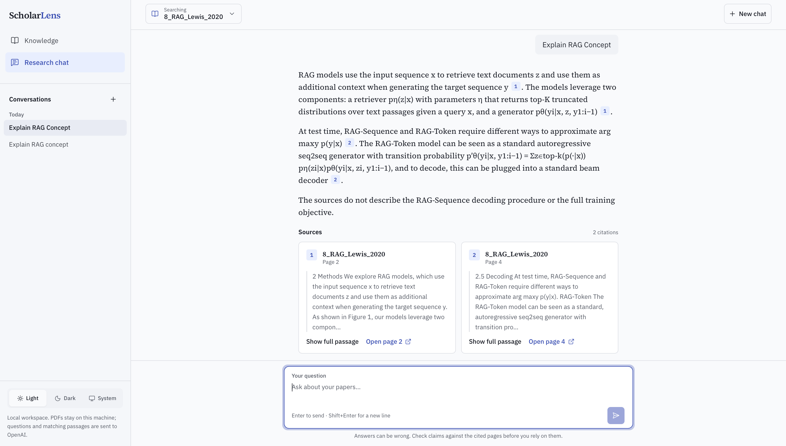
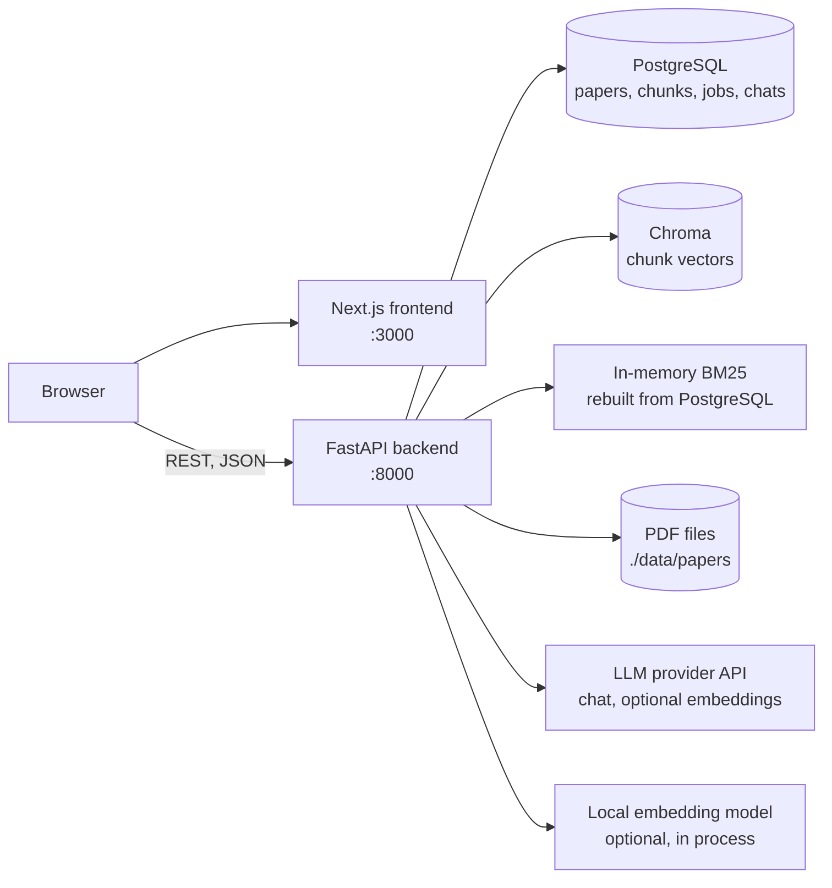
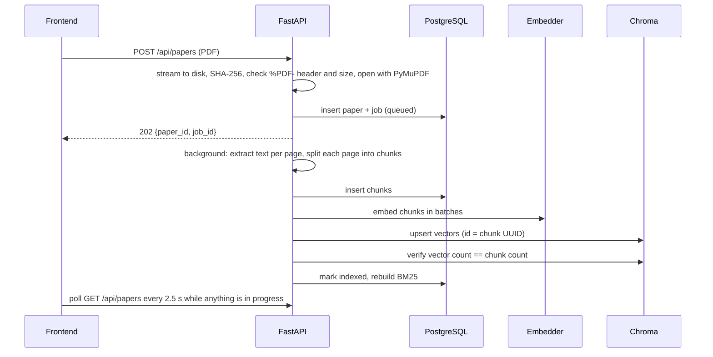

# ScholarLens

A local research assistant for academic PDFs. Upload papers, then ask questions across them and get answers where every claim is cited to a paper and page you can open and check.





## About the project

ScholarLens is a single-user app that runs on your own machine with Docker Compose. It does two things:

1. **Knowledge management.** Add, inspect, and delete PDF papers. Each upload is validated, parsed page by page, chunked, embedded, and indexed in the background while the UI shows its status.
2. **Research chat.** Ask a question across all indexed papers, or a chosen subset. The answer is generated only from retrieved passages, carries numbered citations, and says so when the papers do not support an answer.

PDFs, metadata, vectors, and chat history stay on your machine. The only external calls go to the model provider you configure (OpenAI by default, or any OpenAI-compatible API such as DeepSeek or Gemini): the question plus the top matching passages at chat time, and chunk text at upload when embeddings come from an API. With local embeddings, uploads never leave the machine.

## Architecture



All four services run in Docker Compose. Ports are bound to `127.0.0.1` only, and Chroma has no host port at all.

### Data ownership

| Store | Holds | Role |
|---|---|---|
| PostgreSQL | papers, text chunks, ingestion jobs, chat sessions, messages, cited sources | Source of truth |
| Chroma | one vector per chunk, keyed by the PostgreSQL chunk UUID | Derived index |
| BM25 (in memory) | token index over chunks of `indexed` papers | Derived index, rebuilt at startup, after ingestion, after deletion |
| `./data/papers` | original PDFs, stored as `{paper_id}.pdf` | Raw files |

Because Chroma IDs equal PostgreSQL chunk IDs, the two stores can be reconciled by ID, and a paper is only marked `indexed` after the vector count in Chroma matches the chunk count in PostgreSQL.

### Ingestion



On any failure the partial chunks and vectors are removed, the paper is marked `failed` with a readable reason, and it can be retried from the stored PDF. Duplicate uploads are rejected by file hash before anything is embedded. Jobs interrupted by a restart are marked failed and retryable at startup.

### Answering a question

1. **Sparse retrieval:** BM25 over lowercase word tokens, top 12 chunks.
2. **Dense retrieval:** the question is embedded with the same model and Chroma returns the top 12 by cosine distance.
3. **Fusion:** Reciprocal Rank Fusion, `score = Σ 1 / (60 + rank)`, deduplicated by chunk ID.
4. **Selection:** the top 6 chunks from papers that are still `indexed`, capped at 15,000 characters of context.
5. **Generation:** the passages are sent as `[S1]..[S6]` with paper title and page. The model must cite each claim, answer only from the passages, ignore instructions inside them, and reply with a fixed token when the passages do not answer the question.
6. **Citation check:** markers are renumbered `[1], [2]...` in order of use, markers pointing at nonexistent sources are dropped, and only cited passages are returned as sources.

The scope filter (`paper_ids`) is applied inside both retrievers, so excluded papers never reach the prompt.

### Design decisions

- **Hybrid retrieval with RRF.** BM25 catches exact terms (model names, metrics, acronyms) that embeddings blur; dense retrieval catches paraphrases. RRF merges the two by rank, so no score calibration between them is needed.
- **Chunking inside page boundaries.** Every chunk belongs to exactly one page, which is what makes "Page 4" citations and the "Open page 4" link correct.
- **PostgreSQL as the source of truth.** Chroma and BM25 can be rebuilt from it, so the vector store never holds data that exists nowhere else.
- **One backend worker, in-process jobs.** Enough for a single local user and keeps BM25 consistent. The trade-off is documented: a restart fails in-flight jobs instead of resuming them.
- **Chat history keeps snapshots.** Deleting a paper removes its file, chunks, and vectors, but past answers keep the quoted excerpt and title; only the link to the PDF goes away.

### Keeping model cost low

- No LLM call happens when retrieval finds nothing; the app answers that the papers do not cover the question.
- Context is capped (`FINAL_TOP_K`, `MAX_CONTEXT_CHARS`) and history is limited to the last `CHAT_HISTORY_TURNS` question/answer pairs, with old citation markers stripped.
- Output is capped by `LLM_MAX_OUTPUT_TOKENS` and the prompt asks for answers under 250 words.
- Chat titles come from the first question, not from an extra LLM call.
- Each chunk is embedded once. Duplicate PDFs are rejected before embedding, and adding a paper never re-embeds the others.
- Repeated questions reuse a cached query embedding.
- Every chat and embedding API call logs its token usage in the backend logs, so you can see what a session cost.
- `EMBEDDING_PROVIDER=local` makes indexing free: a small ONNX model (`BAAI/bge-small-en-v1.5`) runs inside the backend.

## Tech stack

| Layer | Choice |
|---|---|
| Frontend | Next.js 16 (App Router, TypeScript), Tailwind CSS 4, shadcn/ui (Radix), TanStack Query |
| Backend | Python 3.12, FastAPI, Pydantic Settings, SQLAlchemy 2, Alembic, uv |
| RAG | PyMuPDF, LangChain `RecursiveCharacterTextSplitter`, `rank-bm25`, Chroma, fastembed |
| Models | Any OpenAI-compatible chat API (default `gpt-4.1-mini`); embeddings from an API (default `text-embedding-3-small`) or local `bge-small-en-v1.5` |
| Storage | PostgreSQL 17, Chroma 1.5 server, local filesystem |
| Runtime | Docker Compose |

## Getting started

### Prerequisites

- Docker with Compose v2: [Docker Desktop](https://www.docker.com/products/docker-desktop/) or [OrbStack](https://orbstack.dev/) on macOS.
- An API key with credit for a chat model. `.env.example` is set up for DeepSeek; OpenAI, Gemini, or another OpenAI-compatible provider also work.

### Run it

```bash
git clone <this-repo> scholar-lens
cd scholar-lens
cp .env.example .env        # then set LLM_API_KEY and POSTGRES_PASSWORD
docker compose up --build
```

Open <http://localhost:3000>. API docs are at <http://localhost:8000/docs>.

The first build downloads the images and dependencies, so it takes a few minutes. Later starts are fast.

Stop with `docker compose down`. Your papers, vectors, and chats survive; only `docker compose down -v` deletes the database and vector volumes.

### Environment variables

Everything lives in one `.env` file at the repo root. The defaults in `.env.example` work as they are; only `LLM_API_KEY` is required. Older `OPENAI_*` names (`OPENAI_API_KEY`, `OPENAI_CHAT_MODEL`, ...) are still accepted.

| Variable | Default | Purpose |
|---|---|---|
| `LLM_API_KEY` | none | Required. Used only by the backend, never sent to the browser. |
| `LLM_BASE_URL` | empty (OpenAI) | Base URL of any OpenAI-compatible chat API. |
| `LLM_MODEL` | `gpt-4.1-mini` | Model that writes answers. |
| `LLM_MAX_OUTPUT_TOKENS` | `700` | Upper bound on answer length, including reasoning tokens on reasoning models. |
| `LLM_TEMPERATURE` | `0.2` | Low, so answers stay close to the passages. |
| `LLM_REASONING_EFFORT` | empty | Reasoning models only, for example `none` (DeepSeek) or `minimal` (Gemini 3). |
| `LLM_MAX_TOKENS_PARAM` | `max_tokens` | Use `max_completion_tokens` for OpenAI o-series and gpt-5 models. |
| `LLM_MAX_RETRIES` | `2` | Automatic retries on rate limits and transient errors. |
| `EMBEDDING_PROVIDER` | `api` | `api` for an OpenAI-compatible embeddings endpoint, `local` for the free in-process model. |
| `EMBEDDING_MODEL` | `text-embedding-3-small` (api), `BAAI/bge-small-en-v1.5` (local) | Changing it requires a re-index (see below). |
| `EMBEDDING_API_KEY` / `EMBEDDING_BASE_URL` | empty | Only for `api` embeddings from a different provider than chat. The key falls back to `LLM_API_KEY`. |
| `EMBEDDING_BATCH_SIZE` | `128` | Chunks per embedding request. |
| `POSTGRES_USER` / `POSTGRES_PASSWORD` / `POSTGRES_DB` | `scholarlens` / `change_me_local_only` / `scholarlens` | Database credentials. Compose builds `DATABASE_URL` from these. Use letters and digits in the password. |
| `CHROMA_COLLECTION` | `scholarlens_paper_chunks_v1` | Vector collection name. |
| `NEXT_PUBLIC_API_BASE_URL` | `http://localhost:8000` | API URL used by the browser. Baked in at build time. |
| `CORS_ORIGINS` | `http://localhost:3000` | Comma-separated origins the API accepts. |
| `MAX_UPLOAD_MB` | `25` | Upload size limit, enforced by frontend and backend. |
| `CHUNK_SIZE` / `CHUNK_OVERLAP` | `800` / `120` | Characters per chunk and overlap. |
| `BM25_TOP_K` / `DENSE_TOP_K` | `12` / `12` | Candidates from each retriever. |
| `RRF_K` | `60` | RRF constant. |
| `FINAL_TOP_K` | `6` | Passages sent to the model. |
| `MAX_CONTEXT_CHARS` | `15000` | Character budget for those passages. |
| `CHAT_HISTORY_TURNS` | `4` | Previous question/answer pairs sent with a new question. |
| `LOG_LEVEL` | `INFO` | Backend log level. |

### Choosing a model provider

The backend speaks the OpenAI API, so any OpenAI-compatible provider works for chat. Embeddings are configured separately, because not every provider offers them. `.env.example` has ready presets:

| Setup | Chat | Embeddings |
|---|---|---|
| DeepSeek (`.env.example` default, cheapest) | `deepseek-flash`, `LLM_REASONING_EFFORT=none` | local `bge-small-en-v1.5`, free (DeepSeek has no embedding API) |
| OpenAI | `gpt-4.1-mini` | `text-embedding-3-small` |
| Gemini | `gemini-3.5-flash-lite`, `LLM_REASONING_EFFORT=minimal` | `gemini-embedding-001` |

Switching only the chat model needs no re-index: edit `.env` and run `docker compose up -d`. Switching the embedding model does: set a new `CHROMA_COLLECTION`, restart, then retry or re-upload your papers.

### First run

1. Go to **Knowledge** and click **Add paper**. Pick one or more text-based PDFs.
2. Each paper moves from Queued to Indexing to Indexed. Scanned PDFs without a text layer fail with an explanation.
3. Go to **Research chat** and ask a question. Use the **Searching** picker to limit the answer to specific papers.
4. Click a citation number to jump to its source card, and **Open page N** to check the passage in the PDF.

## Local development

Run the databases in Docker and the app code on your machine, with hot reload:

```bash
# 1. PostgreSQL on 127.0.0.1:5432 and Chroma on 127.0.0.1:8001
docker compose -f docker-compose.yml -f docker-compose.dev.yml up -d postgres chroma

# 2. Backend on :8000 (reads the root .env)
cd backend
uv sync
uv run alembic upgrade head
uv run uvicorn app.main:app --reload --port 8000

# 3. Frontend on :3000, in another terminal
cd frontend
npm install
npm run dev
```

### Tests and checks

```bash
cd backend
uv run pytest          # validation, chunking, BM25, RRF, citations, request validation
uv run ruff check .
uv run ruff format --check .

cd ../frontend
npm run lint
npx tsc --noEmit
```

## Project structure

```text
scholar-lens/
├── backend/
│   ├── app/
│   │   ├── api/            # routers (papers, chats, health) and dependency wiring
│   │   ├── core/           # settings, logging, error types
│   │   ├── db/             # SQLAlchemy models and session
│   │   ├── ingestion/      # upload validation, PDF parsing, chunking
│   │   ├── retrieval/      # embedders, BM25, Chroma, RRF fusion, hybrid retriever
│   │   ├── generation/     # chat LLM client, prompt, citation resolution
│   │   ├── schemas/        # request and response models
│   │   ├── services/       # paper, ingestion and chat workflows
│   │   └── main.py
│   ├── alembic/            # migrations
│   └── tests/
├── frontend/
│   └── src/
│       ├── app/            # routes: /knowledge, /chat
│       ├── components/     # shadcn/ui primitives and the app shell
│       ├── features/
│       │   ├── papers/     # API calls, query hooks, Knowledge page components
│       │   └── chat/       # API calls, query hooks, chat components
│       └── lib/            # API client, env, formatting
├── data/papers/            # uploaded PDFs (git-ignored)
├── img/                    # README screenshots
├── docker-compose.yml
├── docker-compose.dev.yml
└── .env.example
```

## API

| Method | Endpoint | Purpose |
|---|---|---|
| `POST` | `/api/papers` | Upload a PDF (multipart `file`). Returns `202` with `paper_id` and `job_id`. |
| `GET` | `/api/papers` | List papers, newest first. |
| `GET` | `/api/papers/{id}` | Paper details. |
| `GET` | `/api/papers/{id}/file` | The PDF, inline. |
| `GET` | `/api/papers/{id}/jobs/latest` | Latest ingestion job. |
| `DELETE` | `/api/papers/{id}` | Delete the paper, its file, chunks and vectors. |
| `POST` | `/api/papers/{id}/retry` | Retry a failed ingestion or an unfinished deletion. |
| `POST` | `/api/chats` | Create a chat session. |
| `GET` | `/api/chats` | List sessions. |
| `GET` | `/api/chats/{id}/messages` | Messages with their cited sources. |
| `POST` | `/api/chats/{id}/messages` | Ask a question: `{"question": "...", "paper_ids": null}`. |
| `GET` | `/api/health` | Liveness. |
| `GET` | `/api/ready` | Database and Chroma readiness. |

Errors use `{"detail": "..."}`. A duplicate upload returns `409` with the existing `paper_id`.

## Operations

**Back up.** Stop the stack, then copy all three together so they stay consistent: a `pg_dump` of the database, the `scholarlens_chroma_data` volume, and `./data/papers`.

**Change the embedding model or chunking.** Vectors from different models cannot be mixed. Set a new `CHROMA_COLLECTION` name, run `docker compose down -v` to clear the database, and upload the papers again.

**Start from scratch.** `docker compose down -v` and delete the files in `data/papers/`.

## Limitations

- Text-based PDFs only. Scanned PDFs need OCR first.
- Multi-column layouts can come out in an imperfect reading order, which can split a sentence across chunks.
- Follow-up questions are retrieved as written. A question like "what about the second one?" retrieves poorly because there is no query rewriting yet.
- No streaming: the answer appears once it is complete.
- Single user, no authentication. Keep it on localhost.
